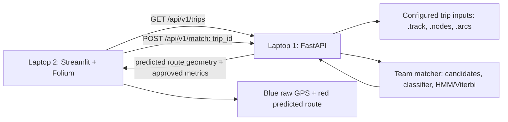

# Report Section 6 — Two-Laptop Deployment (Draft)

**Status:** Implementation draft; final performance and demonstration claims await the team matcher, evaluator data, and a cross-laptop run.

## Proposed architecture

The API's current proposal sends the selected trip ID. Laptop 1 loads the matching raw GPS and network files, calls the team matcher, and returns the result for Laptop 2 to display. The repo also contains descriptions of a raw-array request. The team must resolve the location of evaluator inputs and the exact request schema before final integration. Under every option, ground-truth labels must stay out of the network payload, prediction path, and UI.

## Data and display boundaries

- Each trip uses its own node and arc files. The server must not assume IDs are shared across trips.
- Coordinates are longitude then latitude. Metric calculations in the matching pipeline must use UTM Zone 32N (EPSG:32632).
- The live UI shows raw GPS in blue and the predicted route in red. It does not load trip files locally or display a reference-route layer.
- Student-test reference files are for offline development only. They are not configured as live evaluator inputs.
- The API response exposes only predicted route fields and an allowlist of aggregate numeric metrics.

## Current implementation and observed state

| Component | Current state |
|---|---|
| FastAPI health endpoint | Running locally and returned HTTP 200. |
| Health readiness | `ready: false`; matcher module is not configured. |
| Evaluator data directory | Not configured; zero evaluator trips available to the API. |
| Trip listing | Implemented as directory discovery; no IDs are hardcoded. |
| Match endpoint | Implemented with a matcher adapter; returns 503 until the real engine is ready. |
| Folium UI | Implemented, but not yet run against the team matcher or evaluator data. |
| MLP | Training workflow is implemented; no feature table or frozen schema has been handed off, so no model has been trained. |
| Two-laptop connection | Not verified. The current Wi-Fi profile is Public; no firewall exception was added. |

## Performance results

No end-to-end inference latency or per-stage latency has been measured. The repo's under-85-ms figure is a target, not a result. Fill this table only from a real run on the final two-laptop setup:

| Measurement | Result |
|---|---|
| Feature/candidate generation | Not measured |
| Classifier inference | Not measured |
| HMM/Viterbi decoding | Not measured |
| API serialization and network time | Not measured |
| End-to-end latency per trip | Not measured |
| Successful evaluator trips out of 10 | Not measured |

## Failure handling and remaining checks

- Missing matcher: API returns HTTP 503 and does not fabricate a route.
- Missing trip files: API returns HTTP 404; malformed columns or invalid coordinates return HTTP 422.
- Missing evaluator directory or fewer than 10 evaluator trips: health remains `ready: false`.
- Unreachable API: UI shows the request error and does not fall back to cached output.
- Before final use: configure the real matcher and evaluator inputs on Laptop 1; verify requests from Laptop 2 over a trusted shared network; run every evaluator trip; record actual latency and allowed server metrics; capture the Folium and API screenshots.

## Evidence to add after integration

Add the actual health response, a live Laptop 2 request, the Folium map screenshot, API log excerpt, and measured latency table. Do not add evaluator reference routes or fabricate results.
