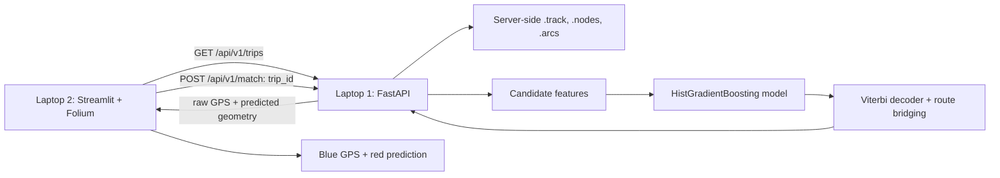

# Report Section 6 — Distributed Deployment and Evaluation

**Status:** Implementation and local development artifacts are committed. The live two-laptop check and organizer evaluator run remain pending.

## Distributed design

The UI sends a trip ID. Laptop 1 reads the selected trip's raw inputs, creates candidate features, scores them with the saved classifier, decodes a path, and returns the raw GPS and predicted route geometry. The API inference call uses `load_trip(..., include_route=False)`. Reference labels are not read by inference or returned to the client.

## Development results

These values come from saved local experiment artifacts and use the 80-trip training partition plus the 10-trip student-test partition. They are not organizer-evaluator results and have not been rerun after committing the integration.

| Metric | Result | Interpretation |
|---|---:|---|
| Untuned HistGradientBoosting five-fold CV candidate macro F1 | 0.8546 | GroupKFold by trip on training data |
| Tuned HistGradientBoosting five-fold CV candidate macro F1 | 0.8567 | 25 Optuna trials; same training folds |
| Tuned model student-test candidate macro F1 | 0.8785 | Offline candidate classification on student-test |
| Tuned model student-test top-1 accuracy | 0.8190 | Candidate classifier top-1 selection |
| Bridged route continuity | 0.9996 | Offline comparison against student-test reference routes |

Candidate classification scores are not final decoded route accuracy. Route continuity was measured offline against student-test reference routes, which are used only for development evaluation.

## Data boundary and readiness

- Laptop 1 reads `.track`, `.nodes`, and `.arcs`; its inference path does not open `.route`.
- Laptop 2 sends `trip_id` only and renders the API response. It does not load trip files or reference labels.
- A local preview can use the checked-in `student_test` raw inputs. The health endpoint correctly keeps `ready: false` for `PATHSNAP_DATA_KIND=student_test`.
- `ready: true` requires a loaded model, `PATHSNAP_DATA_KIND=evaluator`, and exactly 10 organizer-provided evaluator trips.
- Student-test data must not be described as the hidden evaluator partition.

## Performance and remaining verification

No end-to-end two-laptop latency is claimed. The local saved classifier inference timing is not the same as complete candidate generation, decoding, serialization, and network time. The ZIP's 1.40 ms latency and 100% continuity claims are not used as measurements.

After committing, verify the API health and match endpoints locally, run the UI against Laptop 1, confirm the red predicted path, and then repeat across two laptops on a shared trusted network. Record actual API timing and only the metrics permitted by the evaluator contract. The organizer evaluator partition is still needed for final evaluator results.
