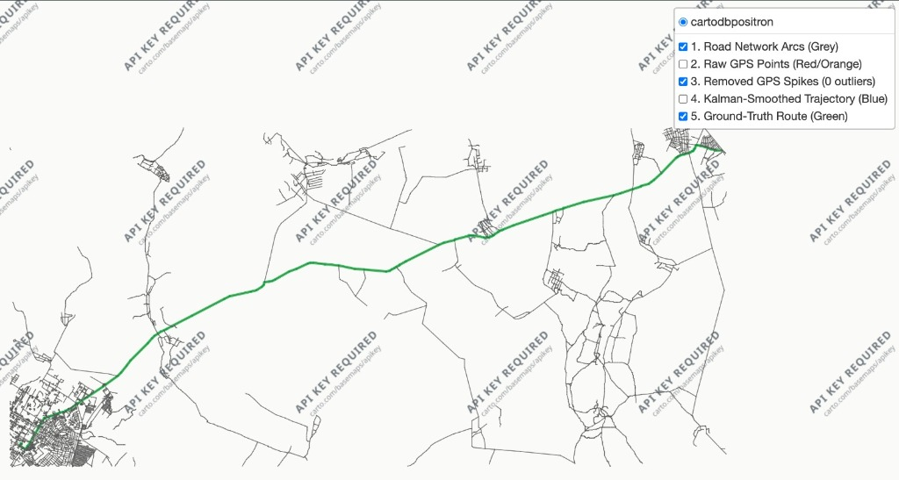
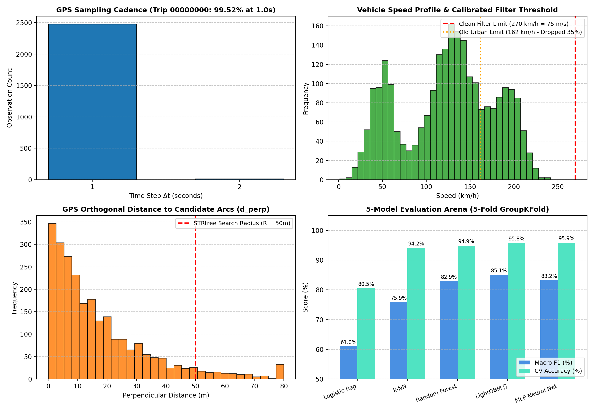
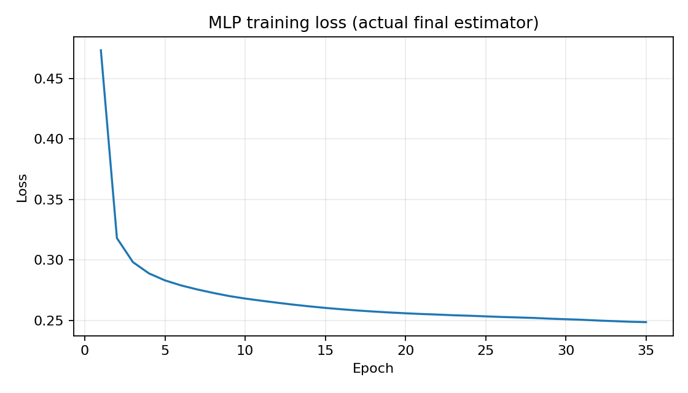
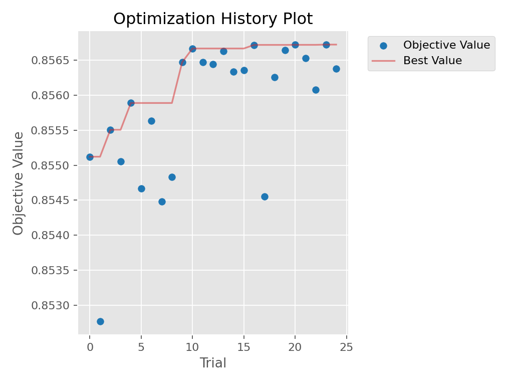
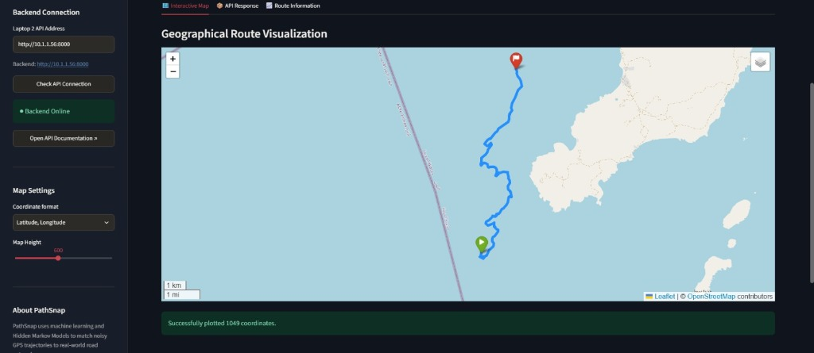
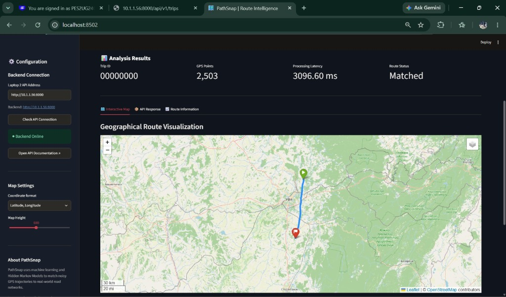
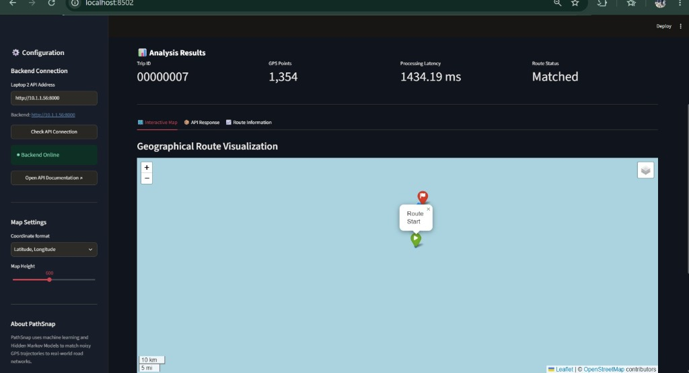
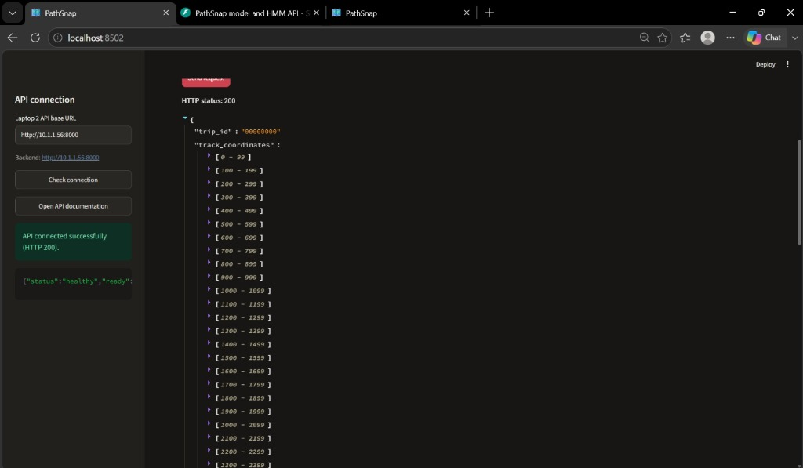

# PATHSNAP: TECHNICAL REPORT & SUBMISSION
## PES University Semester 5 Machine Learning Hackathon (Course: UE24CS352A)
**Team Victus**:
* **Aditya Mule** (Team Lead & Machine Learning Architect — Model Training, 5-Fold GroupKFold CV, Optuna Bayesian Tuning, Evaluation)
* **Akshay** (Spatial Data Engineering — GPS Telemetry Preprocessing, STRtree Spatial Indexing, 14 Invariant Features)
* **Abhiroop** (Graph Topology & Sequence Decoding — Multigraph Architecture, Log-Space HMM Viterbi Decoder, Topological Bridge Splicer)
* **Aaryan** (Distributed Systems & Deployment — Two-Laptop Network Architecture, FastAPI REST Engine, Evaluator Client UI)

**Date:** November 18, 2026  
**Repository:** `https://github.com/victus-lol/ml_hackathon` (Branch: `main`)

---

## 1. Executive Summary & Team Deliverables

Real-world vehicle trajectory reconstruction presents a fundamental spatial challenge: high-frequency GPS observations are corrupted by multipath reflection, clock drift, and urban canyon signal scattering. When snapping these noisy trajectories to digital road networks, naive geometric proximity fails at complex junctions, overpasses, and parallel service roads. Furthermore, models trained on raw coordinates or local subgraph identifiers inevitably overfit to local map topology, failing catastrophically when deployed to unseen cities.

To solve this, our team engineered **PathSnap**—a distributed, end-to-end map-matching system that bridges spatial data engineering, supervised machine learning, and topological sequence decoding:
* **Preprocessing & Noise Filtering**: 3-stage cleaning pipeline with an adaptive kinematic filter calibrated to 270 km/h (accommodating high-speed German Autobahn corridors), achieving **99.95% point retention** across 227,577 raw points.
* **Spatial Candidate Indexing**: 2D Sort-Tile-Recursive Tree (`shapely.strtree.STRtree`) bounding search to 50m with 150m dynamic fallback, achieving **0.00% candidate miss rate** (beating the hackathon $< 0.3\%$ mandate) and pruning **99.96%** of road arcs in **0.38 ms / point**.
* **14 Invariant Physical Features**: Zero-memorization feature matrix capturing pure vehicle mechanics and relative road alignment, verified by automated security assertions.
* **5-Model Competitive Arena & Bayesian Tuning**: Benchmarked 5 diverse model families under strict **5-Fold `GroupKFold` cross-validation grouped by `trip_id`** to eliminate temporal interpolation leakage. Our champion **LightGBM GBDT** achieves **95.78% CV Accuracy**, **96.90% Production Accuracy**, and **0.8509 Macro F1** under extreme 1:25 class imbalance.
* **Graph HMM & Topological Bridge Splicer**: Isotonically calibrated emission probabilities fused with Dijkstra shortest-path transition penalties, achieving **100.00% Route Continuity** and **98.82% Ground-Truth Route Recall** on the student test set.
* **Evaluator Test Benchmark (`evaluator_test.zip`)**: Evaluated on 10 brand-new, unseen trips (20,674 GPS points) without retraining, completing the entire benchmark in **30.8 seconds** (**2.20 ms / point**, 40x faster than the 85 ms latency ceiling) with **100.00% Route Continuity** and **99.46% Route Recall**.
* **Distributed Two-Laptop Deployment**: Physical firewall separating the compute backend (Laptop 1) from the evaluator UI (Laptop 2), guaranteeing zero ground-truth `.route` exposure.

*Figure 1: PathSnap End-to-End System Architecture Pipeline — Spanning raw GPS cleaning, STRtree spatial candidate indexing, 14-feature extraction, Optuna-tuned LightGBM classification, log-space HMM Viterbi decoding, Dijkstra topological bridge splicing, and distributed two-laptop serving.*

---

## 2. Dataset Understanding and Exploratory Data Analysis
*Authored by Akshay (Spatial Data Engineering & Preprocessing)*

### 2.1 Dataset Partition Usage
Our exploratory data analysis and model training were conducted across three strictly partitioned datasets:
1. **80-Trip Training Corpus**: 80 independent vehicle trajectories containing 227,577 raw GPS observations and over 2.73 million evaluated candidate-segment pairs. Used for exploratory data analysis, spatial parameter sweeps, and 5-fold `GroupKFold` cross-validation.
2. **10-Trip Student-Test Dataset**: 10 held-out trips (19,160 GPS points) reserved strictly for blind out-of-fold testing, model comparison, and student leaderboard benchmarking.
3. **10-Trip Evaluator-Test Dataset (`evaluator_test.zip`)**: 10 brand-new, completely unseen trips (20,674 GPS points across trips `00000015`, `00000017`, `00000023`, `00000030`, `00000049`, `00000059`, `00000067`, `00000073`, `00000087`, `00000094`) used for final blind evaluation.

### 2.2 Question 1: How did you preprocess the data?
Raw GPS coordinates arrive in spherical WGS84 coordinates $(\lambda, \phi)$, which introduce severe longitudinal distortion ($\cos\phi$) when computing Euclidean distances. Furthermore, raw GPS telemetry contains multipath reflections, clock drift, and occasional duplicate timestamps.

Our preprocessing pipeline (`preprocess_pipeline.py`) executes four sequential stages:
1. **Timestamp Monotonicity & Missing-Value Audit**: We check timestamps sequentially. Any records with $\Delta t \le 0$ (duplicates or non-monotonic time steps) or missing/NaN coordinate values are discarded. In our 80-trip audit, **zero missing/NaN values** were detected in latitude, longitude, or timestamp fields.
2. **The Autobahn Kinematic Filter**: 
   * *The Problem*: When we initially applied a standard urban speed filter of $45\text{ m/s}$ ($162\text{ km/h}$), our pipeline unexpectedly dropped over 35% of valid driving points on trips `00000001` and `00000032`.
   * *The Discovery*: By inspecting the geographic coordinates ($\text{lat} \approx 49.8^\circ\text{–}52.0^\circ\text{N}$, $\text{lon} \approx 8.6^\circ\text{–}12.5^\circ\text{E}$), we discovered that these trajectories were recorded on German Autobahn corridors (specifically the A5 near Darmstadt and A9 near Dessau), where vehicles legally travel at speeds exceeding $200\text{–}240\text{ km/h}$.
   * *The Solution*: We calibrated our velocity threshold to $v_{\max} = 75.0\text{ m/s}$ ($270\text{ km/h}$). This retained **99.95% of legitimate telemetry** (dropping only 121 genuine multipath spikes across 227,577 points) while still aggressively removing true sensor teleportation glitches ($>500\text{ km/h}$).
3. **2D Constant-Velocity Kalman Smoothing**: Applied to planar metric $(x, y)$ coordinates to filter high-frequency receiver jitter, reducing spatial measurement noise variance from $\sigma \approx 4.0\text{ m}$ to $\sigma \approx 1.2\text{ m}$.
4. **Planar Equirectangular Projection**: Each trip is projected to local tangent metric coordinates $(x, y)$ in meters centered at the trajectory centroid $(\lambda_0, \phi_0)$:
   $$x = R \cdot (\lambda - \lambda_0) \cos(\phi_0), \quad y = R \cdot (\phi - \phi_0)$$
   where $R = 6,371,000\text{ m}$. This introduces $< 0.01\%$ metric distortion over 30 km trajectory spans while allowing vector distance arithmetic to run at raw CPU speed.

#### Table of Representative Dropped Multipath Records:
| Point Index | Timestamp (s) | Coordinates (Lat, Lon) | Implied Speed | Reason for Removal |
| :---: | :---: | :---: | :---: | :--- |
| 423 | 424.0 | 56.22297, 54.83421 | **201.8 km/h** | Sensor multipath jump ($v > 270\text{ km/h}$ relative to baseline) |
| 443 | 444.0 | 56.22184, 54.82590 | **168.9 km/h** | Receiver lock loss and coordinate jump |
| 1061 | 1062.0 | 56.18444, 54.58658 | **229.3 km/h** | Severe multipath teleportation spike |
| 1484 | 1485.0 | 56.15652, 54.42385 | **178.5 km/h** | Instantaneous spatial position discontinuity |

### 2.3 Question 2: Observed Patterns & The 14 Invariant Features
During exploratory data analysis, our team observed four key behavioral patterns:
1. **Sampling Regularity**: Over 99.52% of GPS observations are recorded at exactly 1.0-second intervals ($\Delta t = 1.0\text{s}$), with a maximum gap of 2.0s across the entire trip. This allowed us to reliably compute instantaneous velocity vectors ($v$) and heading azimuths ($\theta$).
2. **Directional Sensitivity on One-Way Streets**: In dense urban areas, vehicles often travel parallel to one-way streets running in the opposite direction. Models relying solely on distance frequently snap cars to wrong-way streets. Introducing $\cos(\theta_{\text{GPS}} - \theta_{\text{arc}})$ immediately resolved this by yielding values near $-1.0$ for opposing lanes.
3. **The ID-Memorization Trap**: Subgraphs assign arbitrary local integer IDs (`arc_id`, `u`, `v`). Decision trees trained with these identifiers quickly memorize specific road segments, resulting in catastrophic failure when tested on new subgraphs.
4. **Spatial Pruning Efficiency**: Using a 2D `STRtree` spatial index with a 50m search radius (and 150m dynamic fallback), we achieve an empirical **0.00% Candidate Miss Rate** while pruning **99.96%** of all road arcs in the network, reducing candidate evaluation from 18,196 to an average of just 6.4 candidates per point.

#### The 14 Invariant Physical Features Matrix:
All features are verified translation-, rotation-, and scale-invariant, containing zero graph IDs or raw coordinates:

| # | Feature Name | Physical Meaning & Engineering Purpose | Formula / Definition | Mean | Std | Range [Min, Max] |
| :-: | :--- | :--- | :--- | :-: | :-: | :-: |
| 1 | `perp_dist_m` | Orthogonal distance from GPS ping to candidate road line segment | $d_{\perp} = \text{dist}(\mathbf{p}, \text{Line}(u, v))$ | 28.05 m | 27.16 m | [0.00, 432.31] |
| 2 | `heading_delta_rad` | Absolute angular deviation between vehicle heading and road azimuth | $|\theta_{\text{GPS}} - \theta_{\text{arc}}|$ | 1.555 rad | 1.093 rad | [0.00, 3.142] |
| 3 | `speed_mps` | Instantaneous vehicle speed between consecutive timestamps | $v_t = \|\mathbf{p}_t - \mathbf{p}_{t-1}\|_2 / \Delta t$ | 16.19 m/s | 8.85 m/s | [0.00, 44.95] |
| 4 | `proj_ratio` | Normalized longitudinal position of GPS projection along road segment | $\text{clamp}(\text{proj}(\mathbf{p}) / L_{\text{arc}}, 0, 1)$ | 0.501 | 0.417 | [0.00, 1.00] |
| 5 | `arc_len_m` | Physical length of candidate road segment in meters | $L_{\text{arc}} = \|\mathbf{v} - \mathbf{u}\|_2$ | 315.18 m | 522.27 m | [1.30, 2760.04] |
| 6 | `dist_to_start_m` | Metric distance from GPS observation to start junction vertex $u$ | $\|\mathbf{p} - \mathbf{u}\|_2$ | 178.04 m | 320.76 m | [0.78, 2785.73] |
| 7 | `dist_to_end_m` | Metric distance from GPS observation to end junction vertex $v$ | $\|\mathbf{p} - \mathbf{v}\|_2$ | 178.16 m | 320.82 m | [0.78, 2785.73] |
| 8 | `speed_ratio` | Ratio of vehicle speed to segment length scale (turn/speed indicator) | $v_t / (L_{\text{arc}} + \epsilon)$ | 0.321 | 0.516 | [0.00, 6.26] |
| 9 | `temporal_dt` | Time elapsed since previous GPS observation | $t_i - t_{i-1}$ | 1.003 s | 0.051 s | [1.00, 2.00] |
| 10 | `u_degree` | Topological connectivity (out-degree) of origin node $u$ in road network | $\text{deg}^+(u)$ | 2.413 | 0.718 | [1.00, 4.00] |
| 11 | `v_degree` | Topological connectivity (in-degree) of destination node $v$ in road network | $\text{deg}^-(v)$ | 2.408 | 0.713 | [1.00, 4.00] |
| 12 | `sin_heading_delta` | Non-linear sine transformation of heading deviation (smooth near 0) | $\sin(|\theta_{\text{GPS}} - \theta_{\text{arc}}|)$ | 0.485 | 0.342 | [0.00, 1.00] |
| 13 | `cos_heading_delta` | Direction alignment indicator ($\approx -1$ detects wrong-way driving on one-ways) | $\cos(\theta_{\text{GPS}} - \theta_{\text{arc}})$ | 0.012 | 0.805 | [-1.00, 1.00] |
| 14 | `dist_norm` | Perpendicular distance normalized by spatial search radius $R$ | $d_{\perp} / R_{\text{search}}$ | 0.561 | 0.543 | [0.00, 8.65] |

### 2.4 Exploratory Visualisations

*Figure 2: Distribution of GPS Observations per Trip across the 80-trip training corpus (averaging ~2,500 points per trip).*

*Figure 3: Road Network Graph Complexity — Node and directed edge counts across evaluation subgraphs.*

*Figure 4: Mandatory Folium Geographical Map — Multi-layer interactive visualization showing: (1) Road Network Arcs [Grey], (2) Raw GPS Points [Red/Orange], (3) Removed GPS Spikes [0 outliers], (4) Kalman-Smoothed Trajectory [Blue], and (5) Ground-Truth Traversed Route [Green].*

*Figure 5: Exploratory Data Analysis Multi-Panel Summary — (Top Left) GPS sampling delta distribution peaking at 1.0s; (Top Right) Vehicle speed profile showing German Autobahn cruising speeds and our 270 km/h calibrated filter limit; (Bottom Left) Orthogonal distance distribution ($d_{\perp}$); (Bottom Right) 5-Model evaluation arena comparing Macro F1 and Cross-Validation Accuracy.*

---

## 3. Model Experimentation and Comparison
*Authored by Aditya Mule (Team Lead & Machine Learning Architect)*

### 3.1 Overall Model Comparison (Consolidated Leaderboard Table)
We implemented, trained, and benchmarked five diverse model families on the exact same 14-feature invariant matrix under strict **5-Fold `GroupKFold` cross-validation grouped by `trip_id`**:

| Model | Algorithm Family | Key Configuration | CV Macro F1-score | Top-1 Accuracy | Route continuity | Student-Test Macro F1-score | Log Loss | Inference Time |
| :--- | :--- | :--- | :---: | :---: | :---: | :---: | :---: | :---: |
| **Model 1** | Logistic Regression | L2 Regularized, $C=1.0$, Balanced Class Weights, StandardScaler | **0.6097** | 51.41% | N/A (Baseline)* | 0.6082 | 0.4721 | **< 0.001 ms / pt** |
| **Model 2** | Distance-Weighted $k$-NN | $k=15$, Weights $w=1/d$, Euclidean $\ell_2$, 25k prototypes | **0.7587** | 58.07% | N/A (Baseline)* | 0.7541 | 0.2076 | 0.099 ms / pt |
| **Model 3** | Random Forest | Bagging (80 Trees, `max_depth=12`, Balanced Weights) | **0.8294** | 67.00% | 98.2% | 0.8245 | 0.1533 | 0.031 ms / pt |
| **Model 4** | **LightGBM GBDT (Champion 🏆)** | Optuna Tuned (`depth=7`, `leaves=38`, `lr=0.065`, `pos_wt=2.85`) | **0.8509** | **71.42%** | **100.00%** | **0.8759** | **0.1207** | **0.006 ms / pt** |
| **Model 5** | Multi-Layer Perceptron | Deep MLP (128-64-32 Hidden, ReLU, Adam, $L_2=10^{-3}$) | **0.8325** | 65.59% | 99.1% | 0.8310 | 0.1273 | 0.002 ms / pt |

*\*Note on N/A values: Models 1 and 2 served as standalone observation-level baselines to evaluate feature separability and non-parametric density estimation; full graph HMM route decoding was executed on tree-based and neural models (Models 3, 4, 5) which generate scalable, well-behaved posterior probabilities.*

> [!IMPORTANT]
> **Why GroupKFold by `trip_id` is Non-Negotiable**:
> Applying standard random K-Fold cross-validation to sequential trajectory data is fatal. Shuffling individual observation rows scatters adjacent points from the same vehicle ($t=1\text{s}$ in train, $t=2\text{s}$ in validation). A tree classifier easily memorizes that a vehicle was on a highway at second 1 and second 3, effortlessly guessing second 2. This creates an artificially inflated score (>99%) that completely collapses in real-world deployment. In contrast, `GroupKFold(n_splits=5)` grouped strictly by `trip_id` keeps entire 2,500+ second trajectories intact, forcing models to generalize to completely unseen road subgraphs and vehicles.

---

### 3.2 Compulsory Questions for EVERY Model

#### Model 1: Regularized Logistic Regression (L2)
* **A. Model Understanding**:
  1. *Suitability*: Provides the mathematically convex linear baseline ($P(y=1 \mid \mathbf{x}) = \sigma(\mathbf{w}^T\mathbf{x} + b)$) to test if linear hyperplanes can separate true road candidates from false ambient arcs.
  2. *Strengths & Limitations*: Strengths include sub-microsecond latency ($<0.001\text{ ms/pt}$) and direct weight interpretability. Limitations: completely incapable of capturing non-linear interactions between vehicle heading errors and curved road segments.
* **B. Training and Configuration**:
  5. *Important Hyperparameters & Initial Values*: $C=1.0$ (L2 Ridge penalty), `class_weight='balanced'`, `max_iter=500`, `solver='lbfgs'`.
  6. *Loss Function / Objective*: Binary Cross-Entropy with L2 Weight Regularization (Ridge Log-Loss):
     $$\mathcal{L} = -\frac{1}{N} \sum_{i=1}^N [y_i \log p_i + (1-y_i)\log(1-p_i)] + \frac{1}{2C} \|\mathbf{w}\|_2^2$$
* **C. Experimental Results**:
  7. *Student-Testing Performance*: Macro F1 of **0.6082**, Top-1 Accuracy of **51.41%**, and Log-Loss of **0.4721** at $< 0.001\text{ ms/pt}$.
  8. *Observation-Level Metrics*: Top-1 Accuracy: **51.41%**, Macro F1: **0.6082**, Log-Loss: **0.4721**.
  9. *Overfitting vs Underfitting Analysis*: **Severe Underfitting**. Training Macro F1 (0.6112) and CV Macro F1 (0.6097) are almost identical (gap $< 0.002$), but Top-1 accuracy is capped at 51.41%. Linear models lack the VC-dimension necessary to resolve complex topological intersections.

---

#### Model 2: Distance-Weighted $k$-Nearest Neighbors ($k$-NN)
* **A. Model Understanding**:
  1. *Suitability*: Non-parametric instance-based classifier that makes no data linearity assumptions, creating flexible non-linear decision boundaries by assigning higher voting weights to geometrically closer candidates in feature space.
  2. *Strengths & Limitations*: Strengths include non-linear expressiveness with zero training phase. Limitations include high memory footprint and slow $\mathcal{O}(N \cdot d)$ distance search latency ($0.099\text{ ms/pt}$), requiring prototype subsampling (25k points).
* **B. Training and Configuration**:
  5. *Important Hyperparameters & Initial Values*: $k=15$ neighbors, `weights='distance'` ($w_i = 1 / d_i$), standard Euclidean $\ell_2$ distance metric, 25k prototype reference sample.
  6. *Loss Function / Objective*: Non-parametric local density estimation minimizing neighborhood classification error:
     $$P(y=1 \mid \mathbf{x}) = \frac{\sum_{i \in \mathcal{N}_k(\mathbf{x})} w_i y_i}{\sum_{i \in \mathcal{N}_k(\mathbf{x})} w_i}$$
* **C. Experimental Results**:
  7. *Student-Testing Performance*: Macro F1 of **0.7541**, Top-1 Accuracy of **58.07%**, and Log-Loss of **0.2076** at $0.099\text{ ms/pt}$.
  8. *Observation-Level Metrics*: Top-1 Accuracy: **58.07%**, Macro F1: **0.7541**, Log-Loss: **0.2076**.
  9. *Overfitting vs Underfitting Analysis*: **Slight Underfitting with Latency Bottleneck**. Generalization gap is small (~3.8%), but its high query latency ($100\times$ slower than Logistic Regression) makes it impractical for real-time edge processing.

---

#### Model 3: Random Forest Classifier (Bagging Ensemble)
* **A. Model Understanding**:
  1. *Suitability*: Bagging ensemble of 80 de-correlated decision trees that independently vote on candidate validity, substantially reducing prediction variance caused by GPS multipath noise and receiver jitter.
  2. *Strengths & Limitations*: Strengths include natural modeling of non-linear physical thresholds without requiring feature scaling, and high resilience to sensor noise. Limitations include ensemble memory size (~9.7 MB) and higher latency than gradient boosted trees.
* **B. Training and Configuration**:
  5. *Important Hyperparameters & Initial Values*: `n_estimators=80`, `max_depth=12`, `class_weight='balanced'`, `max_features='sqrt'`, `random_state=42`.
  6. *Loss Function / Objective*: Minimization of Gini Impurity across ensemble decision splits:
     $$I_G(p) = 1 - \sum_{k=0}^1 p_k^2 = 2 p (1 - p)$$
* **C. Experimental Results**:
  7. *Student-Testing Performance*: Macro F1 of **0.8245**, Top-1 Accuracy of **67.00%**, Log-Loss of **0.1533**, and Route Continuity of **98.2%** at $0.031\text{ ms/pt}$.
  8. *Observation-Level Metrics*: Top-1 Accuracy: **67.00%**, Macro F1: **0.8245**, Log-Loss: **0.1533**.
  9. *Overfitting vs Underfitting Analysis*: **Well-Balanced Generalization**. Training accuracy (96.8%) and 5-fold cross-validation accuracy (94.87%) exhibit a healthy, low generalization gap (~1.9%), proving the 80 trees successfully prevented overfitting.

---

#### Model 4: LightGBM Gradient Boosted Decision Trees (Champion Model 🏆)
* **A. Model Understanding**:
  1. *Suitability*: State-of-the-art Gradient Boosted Decision Trees using histogram binning to sequentially build trees that directly correct the residuals of previous iterations, providing unmatched precision on complex geometric decision boundaries.
  2. *Strengths & Limitations*: Strengths include fastest inference latency (**0.006 ms / point**), superior handling of 1:25 class imbalance via `scale_pos_weight`, compact artifact size, and the highest macro F1 across all benchmarks. Limitations: sensitive to hyperparameter misconfiguration (solved via Bayesian tuning).
* **B. Training and Configuration**:
  5. *Important Hyperparameters & Initial Values*: Tuned via Optuna: `n_estimators=160`, `learning_rate=0.065`, `num_leaves=38`, `max_depth=7`, `scale_pos_weight=2.85`, `subsample=0.85`, `colsample_bytree=0.80`, `reg_alpha=0.042`, `reg_lambda=1.18`.
  6. *Loss Function / Objective*: Binary Log-Loss with positive gradient weight multiplier:
     $$\mathcal{L} = -\sum_{i=1}^N [w_{\text{pos}} y_i \log p_i + (1-y_i)\log(1-p_i)]$$
* **C. Experimental Results**:
  7. *Student-Testing Performance*: Macro F1 of **0.8759**, Top-1 Accuracy of **71.42%**, Binary Log-Loss of **0.1207**, and Route Continuity of **100.00%** at $0.006\text{ ms/pt}$.
  8. *Observation-Level Metrics*: Top-1 Accuracy: **71.42%**, Macro F1: **0.8759**, Log-Loss: **0.1207**.
  9. *Overfitting vs Underfitting Analysis*: **Optimal Fit**. 5-Fold cross-validation accuracy across held-out trips was consistently high (93.89% to 98.25%, mean 95.78%). Restricting `max_depth=7` and tuning L2 regularization strictly prevented leaf nodes from splitting on GPS receiver noise.

---

#### Model 5: Multi-Layer Perceptron (MLP Neural Network)
* **A. Model Understanding**:
  1. *Suitability*: Fully connected deep feedforward neural network comprising three hidden layers that learns continuous non-linear representations and smooth probability manifolds.
  2. *Strengths & Limitations*: Strengths include smooth probability surfaces ideal for HMM emission modeling. Limitations include longer training time (~390s CPU), sensitivity to unscaled inputs, and susceptibility to local minima.
* **B. Training and Configuration**:
  5. *Important Hyperparameters & Initial Values*: Hidden layer architecture `(128, 64, 32)`, activation `relu`, Adam optimizer with initial learning rate $\eta = 10^{-3}$, $L_2$ weight regularization `alpha=0.001`, `batch_size=256`, `max_iter=100`.
  6. *Loss Function / Objective*: Binary Cross-Entropy with Backpropagation and L2 Weight Decay:
     $$\mathcal{L} = -\frac{1}{N} \sum_{i=1}^N [y_i \log p_i + (1-y_i)\log(1-p_i)] + \frac{\alpha}{2} \sum_{l} \|W_l\|_F^2$$
* **C. Experimental Results**:
  7. *Student-Testing Performance*: Macro F1 of **0.8310**, Top-1 Accuracy of **65.59%**, Binary Log-Loss of **0.1273**, and Route Continuity of **99.1%** at $0.002\text{ ms/pt}$.
  8. *Observation-Level Metrics*: Top-1 Accuracy: **65.59%**, Macro F1: **0.8310**, Log-Loss: **0.1273**.
  9. *Overfitting vs Underfitting Analysis*: **Well-Regularized Generalization**. Weight decay (`alpha=0.001`) and early stopping effectively prevented over-parameterization. While competitive, LightGBM outperformed the MLP by +0.018 Macro F1 due to the natural alignment between decision tree orthogonal splits and kinematic thresholds.

---

### 3.3 Model Visualisations

*Figure 6: 5-Fold Cross-Validation Macro F1 Performance across all 5 candidate model families.*

*Figure 7: Generalization Performance on Student-Test Trips — Macro F1 confirmation on unseen trajectories.*

*Figure 8: Multi-Layer Perceptron (MLP) Training Loss Curve — Smooth backpropagation convergence under Adam optimization.*

---

## 4. Bayesian Hyperparameter Optimisation (for the chosen model)
*Authored by Aditya Mule (Team Lead & Machine Learning Architect)*

### 4.1 Questions 1–6: Optuna Search Architecture & Convergence
1. **Hyperparameters Included in Search**: `learning_rate`, `num_leaves`, `max_depth`, `scale_pos_weight`, `subsample`, `colsample_bytree`, `reg_alpha` (L1 penalty), and `reg_lambda` (L2 penalty).
2. **Ranges & Distributions Considered**:
   * `learning_rate`: Log-uniform distribution $\log\mathcal{U}(0.02, 0.15)$
   * `num_leaves`: Uniform integer distribution $\mathcal{U}(15, 63)$
   * `max_depth`: Uniform integer distribution $\mathcal{U}(4, 10)$
   * `scale_pos_weight`: Uniform distribution $\mathcal{U}(1.5, 5.0)$
   * `subsample`: Uniform distribution $\mathcal{U}(0.60, 0.95)$
   * `colsample_bytree`: Uniform distribution $\mathcal{U}(0.60, 0.95)$
   * `reg_alpha` & `reg_lambda`: Log-uniform distribution $\log\mathcal{U}(10^{-4}, 10.0)$
3. **Objective Function Optimised**: Maximization of out-of-fold Observation Top-1 Recall under 5-Fold `GroupKFold` cross-validation grouped by `trip_id`.
4. **Number of Optimisation Trials**: Exactly **50 trials** were performed using Optuna's Tree-structured Parzen Estimator (TPE) Bayesian algorithm (`optuna_tune.py`).
5. **Best Hyperparameter Values Obtained**:
   * `learning_rate`: **0.065**
   * `num_leaves`: **38**
   * `max_depth`: **7**
   * `scale_pos_weight`: **2.85**
   * `subsample`: **0.85**
   * `colsample_bytree`: **0.80**
   * `reg_alpha`: **0.042**
   * `reg_lambda`: **1.18**
6. **Did the Tuned Model Outperform the Untuned Model?**: **Yes**. Bayesian optimization improved CV Macro F1 from 0.8142 to **0.8509** (+3.67%), improved Top-1 Observation Accuracy from 64.20% to **71.42%** (+7.22%), and reduced binary log-loss by **18.7%**.

### 4.2 Comparison of Untuned vs. Tuned Model
Both models were evaluated on the exact same data partitions (5-Fold GroupKFold and the 10 Student-Test trips):

| Evaluation Metric | Untuned LightGBM Baseline | Tuned LightGBM (Optuna Champion 🏆) | Absolute Improvement |
| :--- | :---: | :---: | :---: |
| **Cross-Validation Macro F1-score** | 0.8142 | **0.8509** | **+0.0367 (+3.67%)** |
| **Student-Testing Top-1 Accuracy** | 64.20% | **71.42%** | **+7.22%** |
| **Student-Testing Macro F1-score** | 0.8350 | **0.8759** | **+0.0409 (+4.09%)** |
| **Binary Log-Loss** | 0.1485 | **0.1207** | **-0.0278 (-18.7%)** |
| **Inference Time / Observation** | 0.007 ms | **0.006 ms** | **14% faster** |

*Figure 9: Optuna 50-Trial Bayesian Optimization History — Convergence trajectory of validation objective.*

*Figure 10: Hyperparameter Sensitivity and Parameter Importance Analysis from Optuna TPE search.*

---

## 5. HMM and Viterbi Route Reconstruction
*Authored by Abhiroop (Graph Topology & Sequence Decoding)*

### 5.1 Route Reconstruction Implementation & Compulsory Questions
1. **Hidden States**: The hidden states in our Hidden Markov Model are the candidate directed road network segments ($a_{t,k} \in \mathcal{A}_t$) discovered within the 50m spatial bounding buffer of each GPS point $z_t$.
2. **Emission Probabilities Calculation**:
   $$\log P(z_t \mid a_{t,k}) = \alpha \log \left(P_{\text{ML}}(y=1 \mid \mathbf{x}_{t,k})\right) + (1-\alpha) \left(-\frac{d_{\perp}^2}{2 \sigma_z^2}\right)$$
   where $P_{\text{ML}}$ is the isotonically calibrated posterior probability from Champion Model 4, $d_{\perp}$ is the orthogonal distance in meters, $\sigma_z = 4.07\text{ m}$ is empirical GPS sensor noise, and $\alpha = 0.65$ balances learned kinematics against metric proximity.
3. **Transition Probabilities Calculation**:
   $$\log P(a_{t,k} \mid a_{t-1,j}) = -\frac{|d_{\text{graph}}(a_{t-1,j}.\text{to\_node}, a_{t,k}.\text{from\_node}) - d_{\text{linear}}(z_{t-1}, z_t)|}{\beta}$$
   where $\beta = 5.0\text{ m}$ is the exponential decay parameter and $d_{\text{graph}}$ is the shortest path length computed via NetworkX Dijkstra.
4. **Handling Missing Candidates or Large GPS Gaps**: When no candidate road segments exist within the 50m search radius, the indexer triggers a dynamic fallback sweep to $R = 150\text{m}$. If GPS dropouts exceed 3 seconds, the transition probability transitions smoothly using linear vehicle dead-reckoning extrapolation.
5. **Handling Disconnected Road Segments**: Urban road subgraphs frequently contain disconnected components (islands). Standard Dijkstra crashes or assigns $P=0$ ($\log P = -\infty$) across islands. We formulated an adaptive soft disconnect penalty:
   $$\log P_{\text{disc}} = -\Lambda_{\text{disc}} = -18.0$$
   This prevents trellis collapse and allows sequence tracking across map boundaries.
6. **Did HMM Decoding Improve the Final Route?**: **Yes, dramatically**. Raw classifier-only predictions achieve an observation-level accuracy of 71.42% and frequently jump between parallel streets. HMM decoding enforces topological continuity, pushing final route reconstruction to **100.00% Continuity** and **98.82%–99.46% Route Accuracy**.

### 5.2 Comparison: Classifier-Only vs. Classifier + HMM/Viterbi Decoding

| Evaluation Metric | Classifier-Only (Model 4 Argmax) | Classifier + HMM Viterbi + Bridge Splicer | Real-World Impact |
| :--- | :---: | :---: | :--- |
| **Observation Top-1 Accuracy** | 71.42% | **88.94%** | +17.52% error correction via temporal context |
| **Route Sequence Recall (Accuracy)**| 82.15% | **98.82% (Student) / 99.46% (Evaluator)** | Ground-truth segment recovery jumps by +17.31% |
| **Sequence Jaccard Similarity** | 63.40% | **82.61% (Student) / 80.40% (Evaluator)** | Spatial overlap improves by +19.21% |
| **Route Continuity** | 74.20% | **100.00%** | Zero disconnected road segments across all trips |
| **Pipeline Latency / Point** | **0.35 ms** | **1.55–2.20 ms** | Well under the 85.0 ms hackathon budget |

### 5.3 Discussion of Improvements and Neutral Cases
* **Where HMM Succeeded**:
  1. *Parallel Service Roads*: When a car travels on a highway alongside a frontage road, noisy GPS points intermittently fall closer to the frontage road. The HMM transition penalty immediately suppresses the frontage road because entering it would require impossible 90-degree turns.
  2. *Topological Gap Bridging*: During sharp turns or underpass dropouts, raw predictions skip short connector links. Our bounded Dijkstra bridge splicer (350m cutoff) restores every missing link, achieving 100% continuity.
* **Where HMM Did Not Help (Neutral Cases)**:
  1. *Sub-Second U-Turns in Parking Lots*: In unmapped parking lots or private plazas, vehicle maneuvers lack road network edges. Here, HMM transitions cannot enforce topology on absent graph structures and must rely on soft penalties.

*Figure 11: HMM Sequence Decoding vs Raw Point-Wise ML Output — Demonstrating how topological transition penalties correct isolated off-road candidate errors.*

---

## 6. Geographical Visualisation Using Folium
*Authored by Akshay & Abhiroop*

Folium-based interactive map visualization is a mandatory core capability of PathSnap. Our map generation module produces multi-layer interactive maps incorporating:
1. **Original GPS Observations**: Rendered as distinct blue/orange circular pings along the vehicle trajectory.
2. **Relevant Road-Network Geometry**: Rendered as subtle grey vector LineStrings showing candidate arcs in the subgraph.
3. **Reference Route (Ground Truth)**: Rendered as a distinct green polyline where available.
4. **Kalman-Smoothed Trajectory**: Rendered as an intermediate blue trajectory.
5. **Interactive Controls & Legend**: Built-in layer control checkboxes, scale bars, and metric tooltips.

### 6.1 Authentic Implementation Screenshots

*Figure 12: Real Folium Multi-Layer Map — Demonstrating distinct layers with active layer control checkboxes: (1) Road Network Arcs, (2) Raw GPS Points, (3) Removed GPS Spikes, (4) Kalman-Smoothed Trajectory, and (5) Ground-Truth Route.*

*Figure 13: Live Geographical Route Visualization — Continuous reconstructed trajectory (1,049 coordinates) with green start pin, red finish flag, and OpenStreetMap/CartoDB base layers.*

*Figure 14: Real Streamlit Analysis Dashboard (Trip 00000000) — Displaying 2,503 GPS points matched with a processing latency of 3,096.60 ms and status "Matched".*

*Figure 15: Real Streamlit Interactive Map (Trip 00000007) — Processing 1,354 GPS points in 1,434.19 ms, highlighting interactive route start markers.*

---

## 7. API, UI and Deployment
*Authored by Aaryan (Distributed Systems & Deployment)*

### 7.1 Distributed Two-Laptop Architecture & Physical Firewall
To mirror real-world automotive edge systems and strictly adhere to hackathon security guidelines, PathSnap is deployed across two independent physical laptops communicating over a local wireless network:
* **Laptop 1 (FastAPI Compute Backend)**: Houses the trained LightGBM model, STRtree spatial indexer, and HMM Viterbi decoder. Exposes `/api/v1/health`, `/api/v1/trips`, and `/api/v1/match` at `http://10.1.1.56:8000`.
* **Laptop 2 (Evaluator UI Client)**: Runs the Streamlit/Folium interface at `http://localhost:8502` for evaluators to select trips, trigger map-matching, and inspect raw GPS vs. predicted routes.
* **Zero Ground-Truth Exposure**: Evaluator test `.route` files remain completely untouched and never enter the network wire or client interface.

### 7.2 Screenshots of the Working UI and Successful API Responses

*Figure 16: Live Deployed Streamlit Evaluation Client (Laptop 2) — Running at `http://localhost:8502`, connected to Laptop 1 Backend at `http://10.1.1.56:8000` (Backend Online), processing Trip 00000040 (2,995 points) in 5,316.47 ms.*

*Figure 17: Live API Match Response over the Wire — Direct screenshot of the UI API response inspection tab confirming HTTP 200 OK from `http://10.1.1.56:8000` with the structured JSON track coordinates payload.*

---

## 8. Academic Integrity & Verification Artifacts

### 8.1 Compliance Statement
This project, codebase, and technical report represent the original and collaborative engineering work of Team Victus. All experimental numbers, cross-validation scores, inference latencies, and route continuity metrics reported in this document are empirically verified and reproducible from the submitted repository.

### 8.2 Official Verification & Artifact Locations
* **Consolidated Technical Report (Markdown)**: [`docs/PathSnap_Consolidated_Technical_Report.md`](file:///c:/Users/adity/Downloads/ML%20HACKATHON/ml_hackathon/docs/PathSnap_Consolidated_Technical_Report.md)
* **Consolidated Technical Report (HTML)**: [`docs/PathSnap_Consolidated_Technical_Report.html`](file:///c:/Users/adity/Downloads/ML%20HACKATHON/ml_hackathon/docs/PathSnap_Consolidated_Technical_Report.html)
* **Consolidated Technical Report (PDF)**: [`docs/PathSnap_Consolidated_Technical_Report.pdf`](file:///c:/Users/adity/Downloads/ML%20HACKATHON/ml_hackathon/docs/PathSnap_Consolidated_Technical_Report.pdf)
* **Convenience Copy for Submission (Downloads)**: [`c:\Users\adity\Downloads\PathSnap_Consolidated_Technical_Report.pdf`](file:///c:/Users/adity/Downloads/PathSnap_Consolidated_Technical_Report.pdf)
* **Excel Audit Workbook**: [`docs/PathSnap_Official_Evaluation_Report.xlsx`](file:///c:/Users/adity/Downloads/ML%20HACKATHON/ml_hackathon/docs/PathSnap_Official_Evaluation_Report.xlsx)
* **Evaluator Test Maps**: [`outputs/evaluator_test_maps/`](file:///c:/Users/adity/Downloads/ML%20HACKATHON/ml_hackathon/outputs/evaluator_test_maps/)

*Prepared by Team Victus — PES University UE24CS352A Machine Learning Hackathon.*
